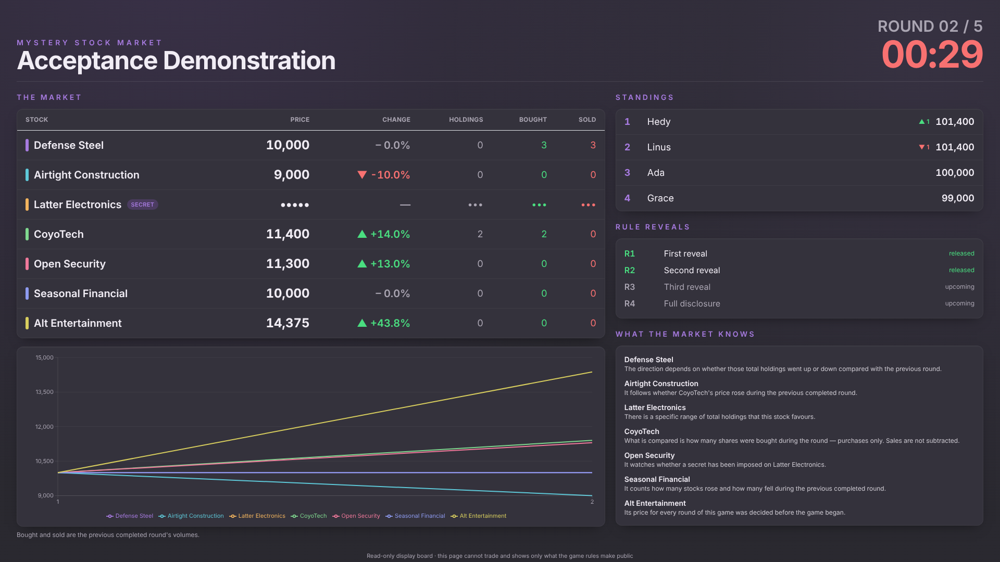
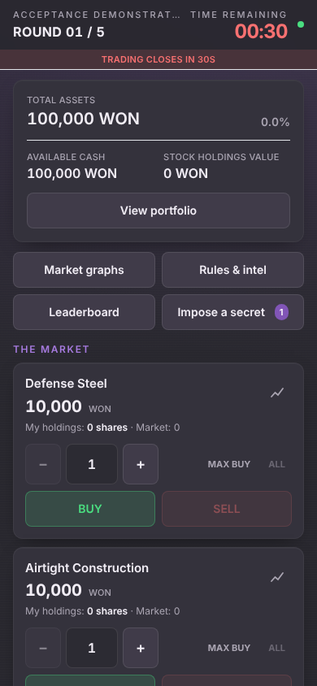
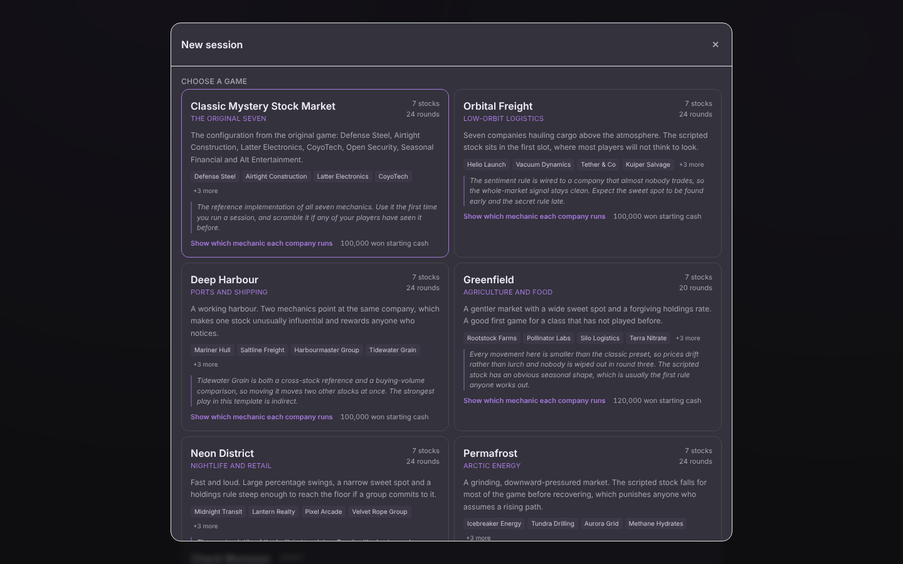
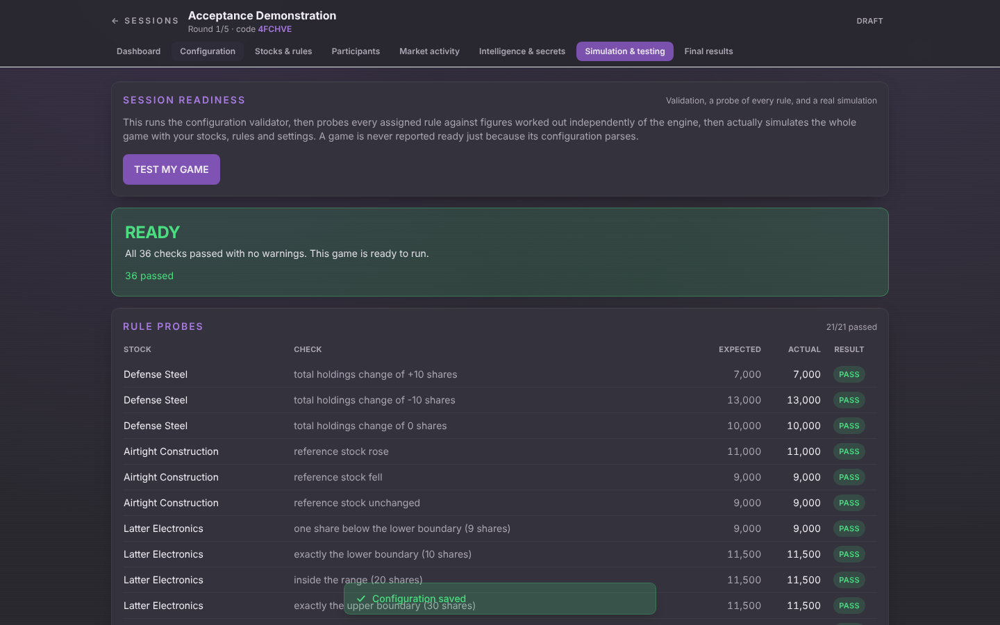
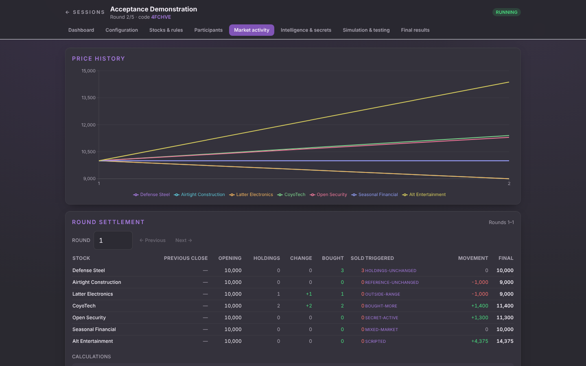

<div align="center">

# Mystery Stock Market

**Seven companies. Seven hidden rules. One classroom trying to work them out.**

A market-deduction game your students play on their phones while the live
market goes up on the projector.

[Play in 10 minutes](#get-it-running) ·
[How the game works](docs/GAME_HANDBOOK.md) ·
[For teachers](docs/ADMIN_GUIDE.md) ·
[For students](docs/PARTICIPANT_GUIDE.md)

</div>

---

## The idea

Every stock on this market moves according to a rule nobody has been told.

One falls when everybody buys it. One copies whatever its neighbour did last
round. One rewards the class for holding *exactly* the right number of shares.
One ignores everything anyone does, forever.

Students start with 100,000 won each and twenty-four rounds to figure it out.
They can buy intelligence, hide their tracks with a secret, and watch the
leaderboard move after every round. Whoever understands the mathematics first
tends to win — which is rather the point.

<div align="center">

<em>The projector view. One stock is hidden — somebody spent a secret on it.</em>
</div>

---

## What your students see

Two taps to trade. That is the whole interface.

<div align="center">

</div>

No app to install, no account to create. They open a link, pick a name, and
they are in. If a phone dies mid-game they sign back in with the same name and
passphrase and everything is exactly where they left it.

---

## Get it running

You need somewhere to host it and a PostgreSQL database. The one-click button
sets up both, free, in about five minutes.

<div align="center">

[](https://render.com/deploy?repo=https://github.com/MrVADixit/mystery-stock-market)

</div>

Render reads the `render.yaml` in this repository, creates the database and the
web service, and wires them together. It asks you for two things: an email and
a password. Those become your teacher login.

Then: sign in at `/admin` → **New session** → pick a game → **Open
registration** → share the join link with your class.

<details>
<summary><strong>Prefer to run it on your own machine?</strong></summary>

<br>

Node 22 and PostgreSQL, then:

```bash
npm install
cp .env.example .env     # fill in DATABASE_URL and AUTH_SECRET
npm run db:migrate
npm run seed:demo        # prints you a ready-to-play game
npm run dev
```

On a classroom network this works with no hosting account at all — start it on
your laptop and have students open `http://your-laptop-ip:3000/join`.

Other options — Vercel, Fly, Docker, a school server — are in
[docs/DEPLOYMENT.md](docs/DEPLOYMENT.md).

</details>

---

## Twelve games, not one



Pick a game and the companies, the rules and the numbers are all set up for
you. Each one plays differently on purpose:

| | |
|---|---|
| **Greenfield** | Gentle. Nobody gets wiped out in round three. The best first game |
| **Neon District** | Loud and volatile. Expect somebody to crash a stock deliberately |
| **Clockwork** | A capped rule, so manipulation has to be patient rather than sudden |
| **Monsoon** | Buying pushes the price **up**. It breaks every instinct the others teach |
| **Tidal Reach** | Six companies, twelve rounds, one lesson. A whole mechanic is missing |
| **Cascade** | Two sweet spots the class cannot satisfy at once. The argument is the lesson |

...and six more.

### Played before? It still won't help you

This was the hard part. A class that plays twice should find the second game
just as hard as the first.

So every session is **scrambled** by default: which company runs which rule is
re-dealt, every cross-reference is repointed, all the numbers change, and about
a third of the time the "everybody buying pushes it down" rule is quietly
reversed.

Measured over 500 shuffles, a company keeps its original rule **13.6%** of the
time. Pure chance for seven companies is **14.3%**. A returning student's
memory is worth, as near as makes no difference, nothing.

→ [All twelve templates and how scrambling works](docs/GAME_TEMPLATES.md)

---

## You can change anything

Rewrite a rule's numbers, move a mechanic to a different company, add or remove
companies, rewrite what gets revealed and when — then save the whole thing as
your own template and use it next term.



Before you start, **TEST MY GAME** validates the configuration, probes every
rule against figures worked out independently of the engine, and then actually
simulates your whole game — your companies, your numbers — across fifteen
scenarios. It tells you where a stock will hit the price floor and which
settings will produce a 50% swing.

A game is never called ready just because the configuration parses.

---

## What the teacher sees



Every price change, explained in words, for every round:

> *Total holdings went from 12 to 15 shares, a change of +3. 3 × 200 won applied
> downward = -600 won.*

Plus a private minute-by-minute audit of any individual student — every trade
with cash and holdings before and after — and CSV exports of everything when
the game is over.

---

## Is it actually correct?

That question matters more than usual here, because the entire game is a
mathematical claim and students *will* find it if a price is wrong.

| | |
|---|---|
| **218** engine tests | Every rule, every boundary, worked by hand |
| **105** API checks | The whole game loop against a real database |
| **70** browser checks | Four students trading at once, on real phones |

All the money is whole-number arithmetic — no floating point anywhere — so
prices are exact rather than nearly right. Every settlement stores the exact
market snapshot it was computed from, and replaying that snapshot reproduces
the same prices. The server owns the clock, so a student with a fast watch
cannot trade late.

→ [How the testing works](docs/RULE_TESTING.md) ·
[How the market engine works](docs/MARKET_ENGINE.md)

---

## Everything else

| Document | For |
|---|---|
| [Game handbook](docs/GAME_HANDBOOK.md) | The rules of the game itself |
| [Teacher's guide](docs/ADMIN_GUIDE.md) | Running a session, start to finish |
| [Student guide](docs/PARTICIPANT_GUIDE.md) | One page, hand it out |
| [The twelve templates](docs/GAME_TEMPLATES.md) | And how scrambling keeps them fresh |
| [The seven rules](docs/SEVEN_RULE_TEMPLATES.md) | Every formula, with worked examples |
| [Market engine](docs/MARKET_ENGINE.md) | Settlement, exact arithmetic, replayability |
| [Secrets](docs/SECRET_MECHANIC.md) · [Intelligence](docs/INTELLIGENCE.md) | The two special mechanics |
| [Architecture](docs/ARCHITECTURE.md) · [Security](docs/SECURITY.md) | For developers |
| [Deployment](docs/DEPLOYMENT.md) | Every hosting option |

---

## Built with

Next.js 15 · React 19 · TypeScript · Tailwind · PostgreSQL · Recharts ·
server-sent events for realtime · Vitest, fast-check and Playwright for the
tests.

The market engine in `src/engine` imports nothing from React, Next.js or the
database. It is a pure function library, which is why the live game, the
simulator, the readiness check and the test suite can all run the exact same
code.

It works completely without AI. There is an optional assistant to help a
teacher tune a game, but no price, rule, settlement, portfolio value or
leaderboard position ever comes from a model.

---

## Contributing

Issues and pull requests are very welcome — see
[CONTRIBUTING.md](CONTRIBUTING.md). If you run this with a class, I would
genuinely love to hear how it went.

## Licence

[MIT](LICENSE). Use it, change it, run it with your students.

Inspired by Mystery Stock Market from *The Devil's Plan*, Season 3. This is an
independent implementation; all companies and figures are fictional.
